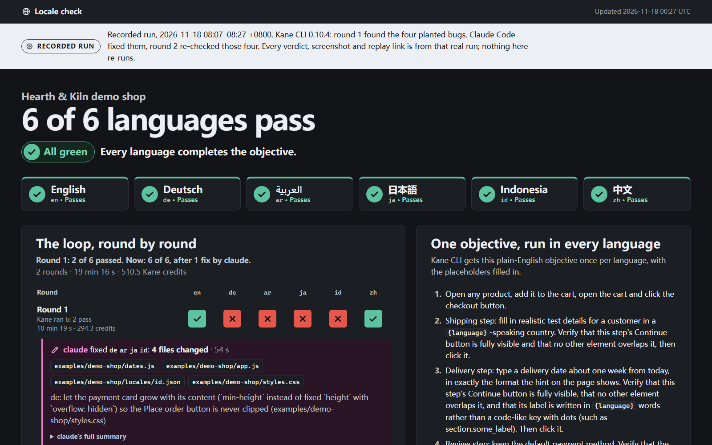

# Locale check

**One plain-English test, every language your app ships. Kane CLI finds what breaks in German, Arabic or Japanese; Claude Code fixes it; Kane re-checks until the grid is green.**



Built for the **Kane CLI Online Hackathon** (TestMu AI, Nov 2026) · **Video:** _TODO_ · **Recorded report (no account needed):** [`examples/recorded/demo-shop/report.html`](examples/recorded/demo-shop/report.html)

## The problem

Translations ship in batches, and nobody on the team reads all of them. String linters check that keys exist. They don't notice that the German "Zahlungspflichtig bestellen" pushes the Pay button out of its card, that an Arabic layout puts a help bubble on top of Continue, that the Japanese date format the page asks for is then rejected, or that a raw key like `checkout.continue_to_payment` is on a button. Users find these, usually at checkout.

## What it does

`locale-check run` runs **one** Kane CLI objective in every locale of your app, in a real Chrome, a few at a time, and writes a one-file report: one tile per language, red or green, with Kane's screenshot, its root cause and fix suggestion, and a link to its step-by-step replay.

`locale-check loop` closes the loop: the failures Kane **confirmed as app bugs** go to Claude Code with Kane's evidence, Claude edits the code, and Kane re-runs **only the red languages**, until everything passes.

```
locale-check.json ──► Kane CLI × locale (en de ar ja id zh) ──► results.json + report.html
        ▲                                                            │ red locales, Kane's verdict,
        │                                                            ▼ NDJSON + screenshot
        └──────── Kane re-runs only red locales ◄──── Claude Code fixes the app (claude -p)
```

## Try it

**In 30 seconds, no account:** open [`examples/recorded/demo-shop/report.html`](examples/recorded/demo-shop/report.html) (download and open it; GitHub shows HTML as source). It is a real recorded run on the demo shop (round 1 red, Claude's fix, round 2 green), with links to Kane's replays.

**Run it yourself** (needs Node 18+, Python for the static server, and a Kane CLI login with credits):

```bash
npm install -g @testmuai/kane-cli && kane-cli login
git clone https://github.com/freddy-tama/locale-check && cd locale-check
python -m http.server 8765 --bind 127.0.0.1          # serves the demo shop (leave running)
node bin/locale-check.mjs run                         # Kane in 6 languages → locale-check-report.html
node bin/locale-check.mjs loop --resume               # Claude Code fixes the red ones, Kane re-checks
git restore examples/demo-shop                        # put the planted bugs back
```

**Use it on your app:**

```bash
npm install -g github:freddy-tama/locale-check
locale-check init            # writes locale-check.json: url with {locale}, locales, objective
locale-check run
locale-check install-skill   # Claude Code skill: "check the locales" → run, fix, re-run until green
```

## The demo shop and what Kane found

`examples/demo-shop/` is a small ceramics store in six languages with **four planted bugs**, each in one language, each the kind of thing a real team ships. They are documented in [`docs/planted-bugs.md`](docs/planted-bugs.md) and are not marked in the code.

| Locale | Planted bug | Kane's bug title in the recorded run (round 1) | Claude's fix (round 1 → 2) |
|---|---|---|---|
| de | Pay card has a fixed height sized for English | "Place order button is clipped by the payment card" | `min-height` instead of `height` + `overflow: hidden` |
| ar | Help pill uses `left:` instead of a logical property; in RTL it covers Continue | "Shipping Continue button is absent from the checkout form" | `inset-inline-start` instead of `left` |
| ja | Date parser reads every `a/b/c` as US MM/DD/YYYY | "Delivery date rejects its own displayed YYYY/MM/DD example" | parse by the locale's own date pattern |
| id | One missing translation key | "Delivery continue button displays untranslated localization key" | add the missing key |
| en, zh | none | pass | |

Kane reports symptoms, not always causes: for Arabic it saw that Continue was not usable ("absent"), not *why*. Claude found the help pill and its physical `left:` in the code. That split is the point of the loop. Claude's whole diff is in [`examples/recorded/demo-shop/claude-fix.diff`](examples/recorded/demo-shop/claude-fix.diff).

## Isn't the objective tailored to the bugs?

A fair question: the demo objective was written by someone who knew the four planted bugs, and it shows ("not cut off by its card"). So we ran a blind test:

1. We wrote a **generic** checkout objective ([`locale-check.generic.json`](locale-check.generic.json)) that names no bug, element or CSS property, and committed it (08:46:16).
2. A separate agent then planted a **fifth bug** in one language and committed it without telling us what or where (08:48:09; [`docs/blind-bug.md`](docs/blind-bug.md) was read only after the run).
3. Kane ran the generic objective in all six languages.

| Bug | Generic objective v1 |
|---|---|
| ar: help pill covers Continue (known) | caught |
| ja: date in the page's own format rejected (known) | caught |
| id: raw translation key (known) | caught |
| de: Pay button half cut off (known) | **missed** |
| zh: shipping ¥2,000 on a ¥198 mug (**blind**) | **missed** |

Three of five. Kane checks what the objective asks: nothing asked whether prices make sense, and "fully visible" without "not cut off at any edge" let the clipped button through. Recorded: [`examples/recorded/blind-test-v1/`](examples/recorded/blind-test-v1/).

Then a second round. We wrote **v2** ([`locale-check.generic-v2.json`](locale-check.generic-v2.json)), still generic, adding "no part of the button cut off by the edge of its box or the screen" and "every price, shipping cost and total looks plausible and adds up", and committed it (08:56:09). The agent planted a **sixth bug** blind (08:58:29; [`docs/blind-bug-2.md`](docs/blind-bug-2.md)).

| Bug | v1 | v2 |
|---|---|---|
| ar, ja, id (known) | caught | caught |
| de: Pay button half cut off (known) | missed | not reached: German failed one step earlier, on the blind bug |
| zh: shipping ¥2,000 on a ¥198 mug (blind in v1) | **missed** | **missed**, even when asked whether prices are plausible |
| de: date hint shows raw `{Format}` / `{Beispiel}` (**blind** in v2) | – | **caught**: "Delivery-date guidance exposes unresolved German template keys" |

**Blind bugs: one of two caught.** Layout, text and validation bugs are where Kane is strong. It took ¥2,000 shipping on a ¥198 mug as plausible because the total adds up; a check like that needs to be concrete ("shipping costs less than the item"), and writing it after the fact would be tuning, so we stopped at v2. Recorded: [`examples/recorded/blind-test-v2/`](examples/recorded/blind-test-v2/).

## A real bug in a real app

Planted bugs prove the loop; they don't prove the tool finds anything on its own. So we went looking in real multilingual open-source apps. A research agent shortlisted eight; on Open Library we noticed by hand that the Arabic page has no `dir` attribute. Then we gave Kane a generic check that names no element and no attribute (interface in the right language, no raw keys, layout direction right for the language) and ran it in five languages.

**[Open Library](https://openlibrary.org)** (Internet Archive, AGPL) ships an Arabic interface. With `?lang=ar`, Kane reported:

> **Arabic homepage retains left-to-right layout.** The Arabic version of the page was loaded, but its page layout was not switched to right-to-left.

It is real and, as far as we can find, unreported: the page has `lang="ar"` but no `dir="rtl"`, so headings sit on the left, rows start from the left and the "view all ›" arrows point the wrong way. Their own design guide says Arabic, Hebrew and Persian layouts "must mirror under `dir="rtl"`", and their CSS rules already use logical properties for it, but the shell template (`openlibrary/templates/shell/base.html.jinja:6`) never sets `dir`. Kane also showed English shelf names (Thriller, Mystery, Fantasy) on the Arabic home page.

- Kane's screenshot and log: [`hackathon/oss/openlibrary/`](hackathon/oss/openlibrary/)
- Draft issue and a small patch (a `dir` property on the layout context): [`ISSUE.md`](hackathon/oss/openlibrary/ISSUE.md), [`fix.patch`](hackathon/oss/openlibrary/fix.patch). _Not filed yet._

One more honest detail: our first Open Library run also searched for a book in every language, and after about ten runs the site started showing a human-verification page. Kane marked every one of those runs as "not an app bug", which is exactly what the inconclusive status is for. We cut the check down to the home page, one language at a time.

## How it works

- **One objective, many locales.** `locale-check.json` holds a URL with `{locale}`, the locale list and an objective written as numbered steps. `{language}` in the objective becomes the language name, so Kane fills a German address for German.
- **Kane CLI does the browsing and the judging.** Each locale is `kane-cli run "<objective>" --url <url> --agent --headless`. Kane reads Arabic and Japanese labels, follows the steps, and checks visibility at each step. Assertions are DOM-based with a vision fallback.
- **Trust what Kane trusts.** On a failure Kane triages itself in `run_end.verdict`: `application_issue` (confirmed app bug) or `automation_bug` (its own misstep). locale-check shows the second as **inconclusive**, retries it once, and never sends it to the agent as a bug.
- **Parallel and isolated.** Three locales run at once, each with its own throwaway Chrome profile. The next run starts only after the previous one's browser is up, because kane-cli picks a free debugging port before Chrome binds it.
- **The loop.** `locale-check failures --agent` prints the brief Claude gets: per red locale, Kane's bug title, root cause, suggested fix, last steps, and paths to the NDJSON and screenshot. `loop` pipes it to `claude -p` (file edits only, no shell), records which files changed, and re-runs only the red locales.
- **CI gate.** [`examples/ci/locale-check.yml`](examples/ci/locale-check.yml) fails a pull request while any locale is red (exit code 1) and uploads the report. Written for this project; not yet run in GitHub Actions.

## Honest limits

- Kane needs a TestMu AI login and credits. The 5-step checkout cost about 45–60 credits and 1.5–3.5 minutes per locale; a 6-locale round is about 280 credits and 7 minutes. For the recorded loop, Kane's runs reported 510.5 credits in total; the account balance dropped by 589 over the same 19 minutes.
- Kane's verdicts are AI judgements. Three of the first twelve shop runs failed for Kane's own reasons (it checked a button before reaching it, or clicked before checking); Kane labelled all three as its own misstep, which is why locale-check retries those instead of reporting them as bugs.
- Local Kane runs record step screenshots and an online replay, not a video file.
- Wording matters: positive checks placed at the step where they apply ("Verify that the Continue button is fully visible and no other element overlaps it, then click it") worked; global or negative wording produced false failures.

## Repo map

| Path | What |
|---|---|
| `bin/locale-check.mjs` | CLI entry |
| `src/` | Kane runner, results, report, agent loop, zip reader for Kane evidence packs |
| `skill/locale-check/` | Claude Code skill |
| `examples/demo-shop/` | Six-language demo store with planted bugs |
| `examples/recorded/` | A recorded run for judges without a Kane account |
| `lab/kane-language-test/` | The first-hour test: Arabic, Japanese and a clipped German button |
| `hackathon/` | Plan, rules, log of every cycle with evidence |

MIT licence.
